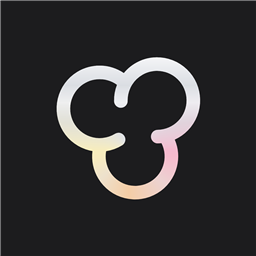

  

<h1 align="center">Popcorn</h1>

Movies and TV shows, for Android and Windows.

<a href="https://popcorn-organization.github.io/popcorn/"><b>Visit the Popcorn website →</b></a>

<!-- latest -->
**Latest version: 3.0.4**, released on 14 November 2026 at 3:30 AM (Sri Lanka time).
<!-- /latest -->

## Download

- **Android:** [Popcorn-Android.apk](https://github.com/popcorn-organization/popcorn/releases/latest/download/Popcorn-Android.apk)
- **Windows:** [Popcorn-Windows-Setup.exe](https://github.com/popcorn-organization/popcorn/releases/latest/download/Popcorn-Windows-Setup.exe)

These links always give you the newest version. Earlier versions are under [Releases](https://github.com/popcorn-organization/popcorn/releases). Install steps are on the [website](https://popcorn-organization.github.io/popcorn/#install).
